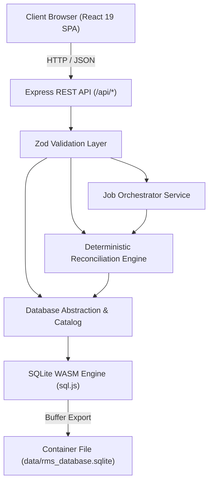

# 01. Technical Specification

**Application Name:** Reconciliation Studio  
**Subtitle:** Dynamic Data Reconciliation & Job Management Platform  
**Document Version:** 2.5.0  
**Status:** Approved & Operational  
**Environment:** Full-Stack Node.js / Express / TypeScript / React 19 / SQLite WASM Embedded Simulator  

---

## 1. Introduction

### 1.1 Overview
Reconciliation Studio is an enterprise data reconciliation and settlement platform simulator designed to automate transaction matching, discrepancy detection, and job orchestration across heterogeneous databases and ledgers. Inspired by banking and commercial Reconciliation & Settlement Platforms (RSP), it provides a complete web-based interface for managing logical databases, dynamic table schemas, matching rule configurations, scheduled job workflows, and detailed audit trails.

### 1.2 Objectives
- **Eliminate Manual Reconciliation:** Automate high-volume record matching between operational transaction sources (e.g., POS orders, bookings, warehouse movements) and verification ledgers (e.g., payment gateways, cashier journals, physical inventory audits).
- **100% Deterministic Matching:** Enforce mathematically exact, reproducible matching rules with configurable numeric tolerances, date cut-off windows, status mappings, and duplicate detection guards.
- **Dynamic Extensibility:** Enable non-technical operators to create new reconciliation pipelines via one-click business templates without modifying backend code or database engines.
- **Zero-Dependency Preview Execution:** Provide immediate, out-of-the-box functionality in preview environments using an embedded WebAssembly SQLite engine that executes real SQL DDL and DML operations.

### 1.3 Scope
The application encompasses:
1. **Interactive Database Management:** Managing logical databases, inspecting physical tables, viewing metadata, running read-only SQL queries, and importing/exporting CSVs.
2. **Dynamic Table Designer:** Creating physical tables without manual SQL writing, supporting UUID, VARCHAR, DECIMAL, DATE, TIMESTAMP, and constraint validation.
3. **Template-Based Module Factory:** Instant provisioning of source tables, target tables, matching rules, jobs, and synthetic test datasets.
4. **Deterministic Reconciliation Engine:** One-to-one matching algorithm, duplicate candidate isolation, priority discrepancy classification, and side-by-side inspection.
5. **Job Orchestration & Monitoring:** Sequential step DAG pipeline, in-process concurrency locking, retry thresholds, millisecond duration tracking, and real-time step logging.
6. **Compliance Reporting & Audit Trail:** Immutable event recording of schema mutations, job runs, and CSV report downloads.

---

## 2. Technology Stack

### 2.1 Frontend
- **Framework:** React 19 (`^19.0.1`) with TypeScript (`^7.0.2`)
- **Build Tool:** Vite 8 (`^8.3.0`)
- **Styling:** Tailwind CSS v4 (`@tailwindcss/vite ^4.3.3`)
- **Iconography:** Lucide React (`^0.546.0`)
- **Animation & Transitions:** Motion (`motion ^12.23.24`)

### 2.2 Backend
- **Runtime:** Node.js (v22+)
- **Execution Tool:** `tsx` (`^4.21.0`) for TypeScript execution
- **Web Framework:** Express (`^4.21.2`) with typed request handlers (`@types/express ^4.17.21`)
- **Validation:** Zod (`^3.24.2`) for runtime API payload schema enforcement
- **Presentation Engine:** PptxGenJS (`^3.12.0`) for real, downloadable `.pptx` file generation

### 2.3 Database & Storage
- **Engine:** SQLite compiled to WebAssembly via `sql.js` (`^1.12.0`)
- **Storage Mode:** Embedded SQLite file buffer written to `./data/rms_database.sqlite`
- **Schema Model:** Logical database catalog (`_rms_databases`, `_rms_tables`, `_rms_columns`) mapped to physical tables (`tbl_<DB>_<table>`)
- **Persistence Guarantee:** In-container persistent file buffer during container lifetime; provides direct migration compatibility to managed PostgreSQL / Cloud SQL.

---

## 3. System Architecture Diagram

---

## 4. Functional Specifications

| Module | Purpose | Input | Output | Related Database Tables |
|---|---|---|---|---|
| **Dashboard** | High-level system overview, KPIs, matching rates, recent runs | User navigation, click triggers | KPI metrics, status distributions, quick run status | `_rms_job_executions`, `_rms_modules` |
| **Database Manager** | Manage logical databases, inspect tables, run SELECT queries | DB name, descriptions, SQL queries, CSV files | Catalog tree, schema details, query result sets | `_rms_databases`, `_rms_tables`, physical tables |
| **Table Designer** | Create tables with structured column types without writing SQL | Table name, column definitions, constraints | Real physical SQLite table, catalog entries | `_rms_tables`, `_rms_columns` |
| **Data Explorer** | Browse and edit table data in a spreadsheet interface | Filter, search, sort, pagination, record edits | Paginated rows, record mutations, CSV export | Physical SQLite tables |
| **Module Management** | Configure matching pipelines and 1-click template provisioning | Module name, source/target tables, rule mapping | Executable module record, physical tables | `_rms_modules` |
| **Matching Rules** | Define equality, tolerance, and duplicate detection rules | Rule name, type, tolerance thresholds | Rule catalog item | `_rms_matching_rules` |
| **Job Designer** | Orchestrate pipelines, visual DAG, execution order | Job name, attached modules, retry limit | Executable job record | `_rms_jobs` |
| **Job Scheduler** | Define cron schedules, timezones, ad-hoc execution | Cron expression, timezone, job ID | Schedule entry | `_rms_job_schedules` |
| **Execution History** | Review execution runs, duration, and detailed step logs | Execution selection, log filter | Status badge, duration, log stream | `_rms_job_executions`, `_rms_execution_logs` |
| **Results Dashboard** | Inspect side-by-side transaction differences and classifications | Execution ID, status filter, keyword search | Side-by-side comparison modal, CSV export | `_rms_reconciliation_results` |
| **Reports & Export** | Generate compliance reports for matched and unmatched data | Report type, execution ID | Downloadable CSV files | `_rms_reconciliation_results` |
| **Audit Logs** | Immutable audit trail of administrative operations | Search query | Filtered audit records | `_rms_audit_logs` |
| **Presentations** | Download editable PowerPoint presentation slides | Download trigger | `Reconciliation_Studio_Presentation.pptx` | Generated via `presentationGenerator.ts` |
| **Documentation** | In-app reading of complete technical specifications | Section selection, keyword search | Rendered documentation & copyable code | Markdown deliverables |
