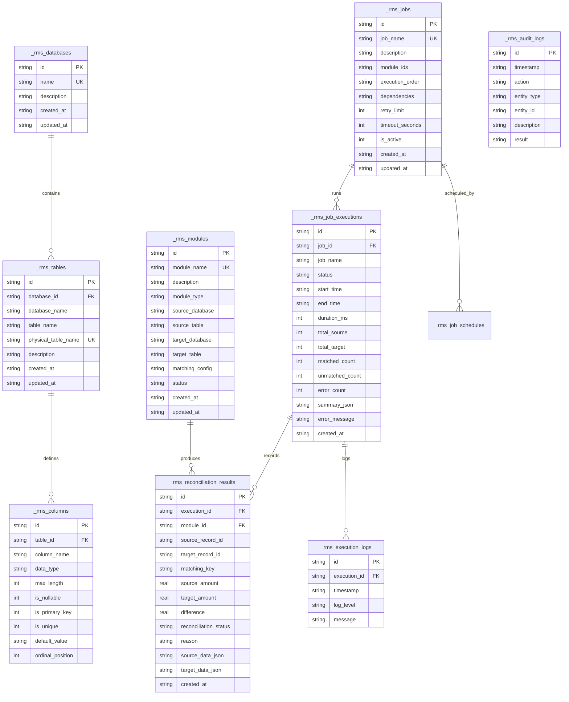

# 03. Database Design

**Engine:** SQLite (WebAssembly `sql.js`) with File Buffer Sync  
**Architecture:** Multi-Schema Logical Catalog with Isolated Physical Tables  
**File Location:** `./data/rms_database.sqlite`  

---

## 1. Overview of Logical Databases

Reconciliation Studio isolates business data into three logical databases:

1. **`DEMO_OPERATIONS_DB`:**  
   Houses operational source tables that record incoming orders, bookings, and inventory movements:
   - `tbl_DEMO_OPERATIONS_DB_coffee_orders`
   - `tbl_DEMO_OPERATIONS_DB_bookstore_orders`
   - `tbl_DEMO_OPERATIONS_DB_ticket_bookings`
   - `tbl_DEMO_OPERATIONS_DB_warehouse_movements`
   - Dynamic user-created source tables (`<module>_source`)

2. **`DEMO_RECORDS_DB`:**  
   Houses verification and settlement target records from gateways, journals, and audits:
   - `tbl_DEMO_RECORDS_DB_coffee_payments`
   - `tbl_DEMO_RECORDS_DB_bookstore_sales`
   - `tbl_DEMO_RECORDS_DB_ticket_payments`
   - `tbl_DEMO_RECORDS_DB_inventory_records`
   - Dynamic user-created target tables (`<module>_target`)

3. **`RECONCILIATION_DB`:**  
   Stores platform catalog metadata, execution histories, step logs, and matching results:
   - `_rms_databases`
   - `_rms_tables`
   - `_rms_columns`
   - `_rms_modules`
   - `_rms_matching_rules`
   - `_rms_jobs`
   - `_rms_job_schedules`
   - `_rms_job_executions`
   - `_rms_execution_logs`
   - `_rms_reconciliation_results`
   - `_rms_audit_logs`

---

## 2. Entity Relationship Diagram (ERD)



---

## 3. Physical Table Schema Examples

### 3.1 Coffee Shop Sales Module
```sql
-- Source Table (DEMO_OPERATIONS_DB)
CREATE TABLE "tbl_DEMO_OPERATIONS_DB_coffee_orders" (
  "id" TEXT PRIMARY KEY,
  "order_id" TEXT NOT NULL,
  "order_date" TEXT NOT NULL,
  "order_amount" REAL NOT NULL,
  "customer_name" TEXT NOT NULL,
  "channel" TEXT NOT NULL,
  "order_status" TEXT NOT NULL
);

-- Target Table (DEMO_RECORDS_DB)
CREATE TABLE "tbl_DEMO_RECORDS_DB_coffee_payments" (
  "id" TEXT PRIMARY KEY,
  "order_id" TEXT NOT NULL,
  "payment_date" TEXT NOT NULL,
  "paid_amount" REAL NOT NULL,
  "payment_method" TEXT NOT NULL,
  "payment_status" TEXT NOT NULL
);
```

### 3.2 Warehouse Inventory Module
```sql
-- Source Table (DEMO_OPERATIONS_DB)
CREATE TABLE "tbl_DEMO_OPERATIONS_DB_warehouse_movements" (
  "id" TEXT PRIMARY KEY,
  "product_code" TEXT NOT NULL,
  "warehouse_id" TEXT NOT NULL,
  "movement_date" TEXT NOT NULL,
  "expected_quantity" REAL NOT NULL,
  "movement_type" TEXT NOT NULL
);

-- Target Table (DEMO_RECORDS_DB)
CREATE TABLE "tbl_DEMO_RECORDS_DB_inventory_records" (
  "id" TEXT PRIMARY KEY,
  "product_code" TEXT NOT NULL,
  "warehouse_id" TEXT NOT NULL,
  "audit_date" TEXT NOT NULL,
  "recorded_quantity" REAL NOT NULL,
  "auditor_name" TEXT NOT NULL
);
```

---

## 4. Automatic Table Provisioning in Templates

When a user calls `POST /api/modules/provision-from-template`, the system executes the following steps:
1. Normalizes the module name into a clean code (e.g. `RESTAURANT_ORDERS_RECON`).
2. Derives physical table names:
   - `tbl_DEMO_OPERATIONS_DB_restaurant_orders_source`
   - `tbl_DEMO_RECORDS_DB_restaurant_orders_target`
3. Runs dynamic SQL DDL statements creating the tables with columns matching the template type.
4. Registers the tables in `_rms_tables` and columns in `_rms_columns`.
5. Optionally seeds deterministic synthetic test records.
6. Saves the module configuration into `_rms_modules` and the job into `_rms_jobs`.
