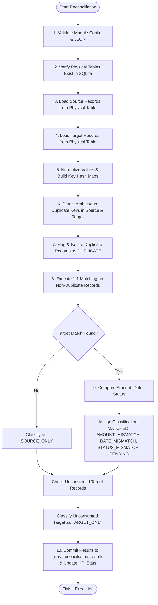
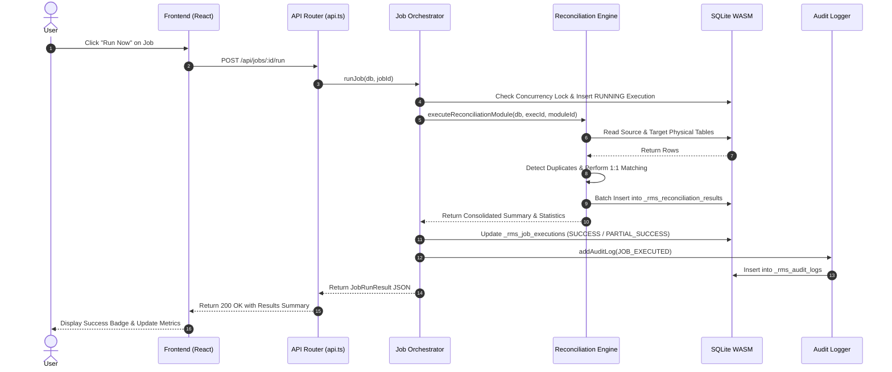

# 04. Reconciliation Engine Specification

**Module:** Reconciliation Matching Engine  
**Implementation:** `server/services/reconciliationEngine.ts`  
**Execution Paradigm:** 100% Deterministic, In-Memory Indexing, One-to-One Consumption  

---

## 1. Overview & Data Extraction

The reconciliation engine reads records directly from physical SQLite tables defined in the metadata catalog.
Given a module configuration:
```json
{
  "sourceDatabase": "DEMO_OPERATIONS_DB",
  "sourceTable": "coffee_orders",
  "targetDatabase": "DEMO_RECORDS_DB",
  "targetTable": "coffee_payments"
}
```
The engine resolves the physical table names:
- `tbl_DEMO_OPERATIONS_DB_coffee_orders`
- `tbl_DEMO_RECORDS_DB_coffee_payments`

Records are fetched using parameterized SQL queries:
```sql
SELECT * FROM "tbl_DEMO_OPERATIONS_DB_coffee_orders";
SELECT * FROM "tbl_DEMO_RECORDS_DB_coffee_payments";
```

---

## 2. Field Mapping & Key Construction

### 2.1 Single and Composite Matching Keys
The engine constructs normalized string keys for each record based on `config.matchingFields`:
- **Single Key:** e.g., `order_id` -> `"CF-202610-001"`
- **Composite Key:** e.g., `product_code` + `warehouse_id` -> `"SKU-001__WH-JAKARTA-01"`

Values are trimmed and converted to uppercase strings. Missing or null keys are assigned the sentinel `"NULL"`.

### 2.2 Dynamic Attribute Extraction
The engine inspects `config.comparisonFields` to extract:
- **Amount Field:** Identifies fields with `comparisonType: "AMOUNT"` (e.g. `order_amount` vs `paid_amount`). Numeric values are parsed and sanitized.
- **Date Field:** Identifies fields with `comparisonType: "DATE"` (e.g. `order_date` vs `payment_date`).
- **Status Field:** Identifies fields with `comparisonType: "STATUS"` (e.g. `order_status` vs `payment_status`).

---

## 3. The 10-Step Reconciliation Algorithm



---

## 4. Result Classification Hierarchy

When evaluating record pairs, the engine resolves classifications deterministically using the following strict priority:

1. **`DUPLICATE`:** Triggered if a matching key appears more than once in source or target. Prevents false settlement pairing.
2. **`PENDING`:** Triggered if either source or target record status is `"PENDING"`.
3. **`AMOUNT_MISMATCH`:** Triggered if `|source_amount - target_amount| > tolerance`.
4. **`DATE_MISMATCH`:** Triggered if transaction dates differ by more than `toleranceDays`.
5. **`STATUS_MISMATCH`:** Triggered if operational statuses differ (e.g. `COMPLETED` vs `REFUNDED`).
6. **`MATCHED`:** Assigned when all configured comparison attributes match within tolerance (100% Match).
7. **`SOURCE_ONLY`:** Assigned to source records with no corresponding target key.
8. **`TARGET_ONLY`:** Assigned to target records with no corresponding source key.

---

## 5. End-to-End Sequence Diagram



---

## 6. Error Handling & Idempotency

- **Missing Physical Tables:** If tables have not been created in SQLite, the engine halts with an informative error: `"Tabel fisik ... belum dibuat dalam database."`
- **Invalid JSON Configuration:** Throws a validation exception and marks execution as `FAILED` with captured stack trace.
- **Concurrency Guards:** Active jobs are held in `activeRunningJobs: Set<string>`. Any simultaneous request to run the same job returns HTTP 409 conflict.
- **Transaction Rollback:** All results are written inside standard transactions or discrete batch insertions to prevent orphaned records.
