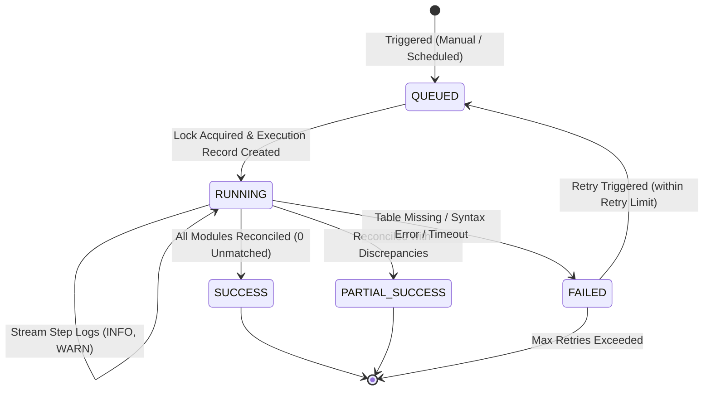

# 05. Job Management Specification

**Service:** Job Orchestration & Scheduling  
**Implementation:** `server/services/jobOrchestrator.ts`  
**Execution Context:** In-Process Task Runner with Concurrency Guard  

---

## 1. Concepts & Distinction of Entities

| Entity | Purpose | Lifecycle | Storage Table |
|---|---|---|---|
| **Reconciliation Module** | Defines *what* to reconcile: source table, target table, key mapping, and tolerances. | Static Configuration | `_rms_modules` |
| **Matching Rule** | Reusable criteria component (e.g., exact match, amount comparison, duplicate detection). | Shared Catalog | `_rms_matching_rules` |
| **Job Definition** | Defines *how and when* to run: pipeline steps, attached modules, retry limit, and timeout. | Static Workflow | `_rms_jobs` |
| **Job Schedule** | Associates a job with a cron trigger and timezone. | Scheduling Rule | `_rms_job_schedules` |
| **Job Execution** | A specific runtime invocation of a job with start/end time, duration, and status. | Ephemeral Run Instance | `_rms_job_executions` |
| **Reconciliation Result** | Individual transaction-level matching outcome (1 row per source/target pair). | Persistent Audit Data | `_rms_reconciliation_results` |

---

## 2. Job Execution Lifecycle Diagram



---

## 3. Job Workflow Pipeline

A job executes an ordered Directed Acyclic Graph (DAG) of processing steps:
1. `EXTRACT_SOURCE`: Reads records from operational source tables.
2. `EXTRACT_TARGET`: Reads records from target verification ledgers.
3. `<MODULE_ID>`: Invokes `executeReconciliationModule()` to perform 1:1 matching and classification.
4. `GENERATE_SUMMARY`: Consolidates totals, calculating matching rate and net financial difference.
5. `AUDIT_COMMIT`: Persists logs and final execution status.

### Concurrency & Locking
To prevent race conditions and conflicting result writes, the orchestrator maintains an in-memory lock set:
```typescript
const activeRunningJobs = new Set<string>();
```
If a job is triggered while its ID exists in `activeRunningJobs`, the request is immediately rejected:
```text
Error: Job '...' sedang berjalan saat ini. Hindari eksekusi ganda bersamaan.
```

---

## 4. Execution Step Logging

Every execution generates structured, timestamped step logs saved in `_rms_execution_logs`:
- `[INFO]`: Operational milestones (e.g. loading tables, counting rows).
- `[WARN]`: Non-fatal issues (e.g. duplicate keys detected, timing cut-off differences).
- `[ERROR]`: Fatal exceptions (e.g. missing tables, unparseable configuration).
- `[SUCCESS]`: Completion notices (e.g. matching rate calculation, transaction commit).

---

## 5. Job Scheduling Specification

Schedules are configured via standard 5-part cron expressions:
- `30 23 * * *` (23:30 every day)
- `0 22 * * *` (22:00 daily end-of-day batch)
- `0 * * * *` (hourly run)

**Simulation Environment Notice:**  
Inside the preview container, scheduled jobs operate in a best-effort in-process mode. Durable production scheduling requires integration with an external managed trigger, such as Google Cloud Scheduler, dispatching webhooks to `/api/jobs/:id/run`.
